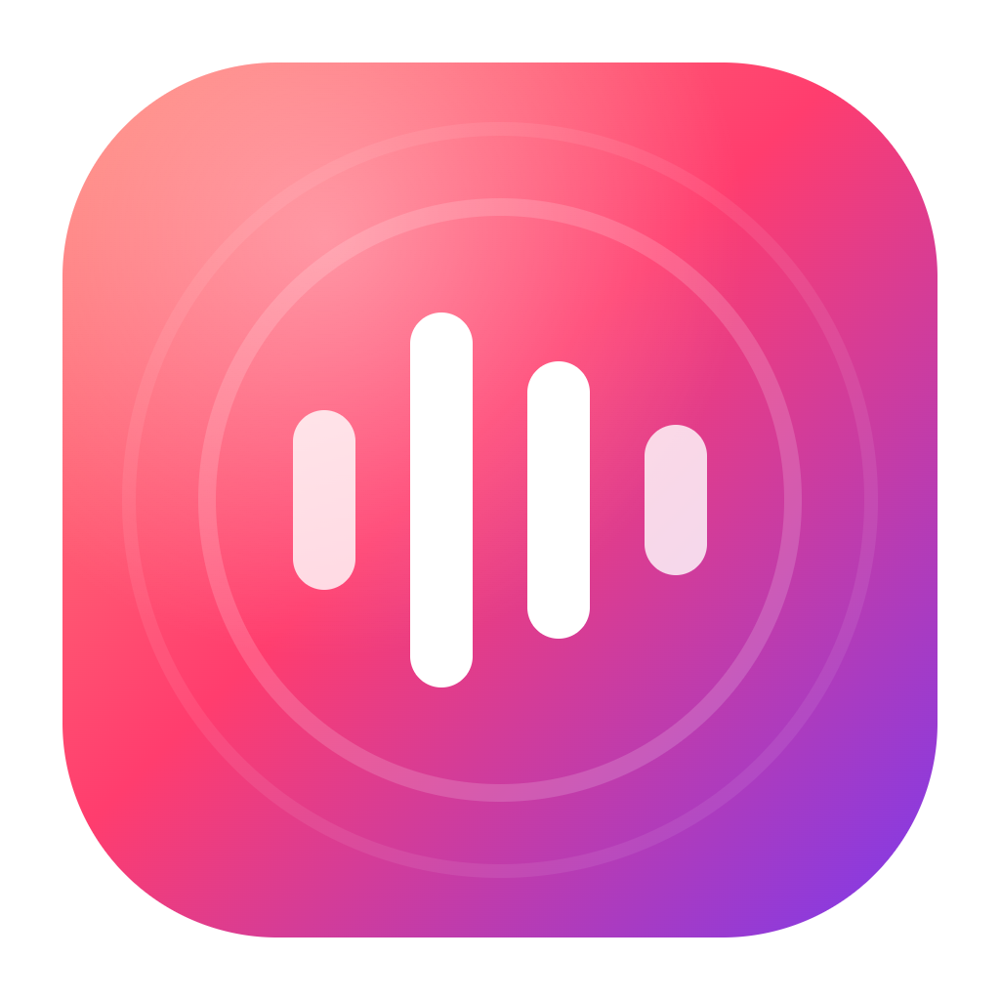
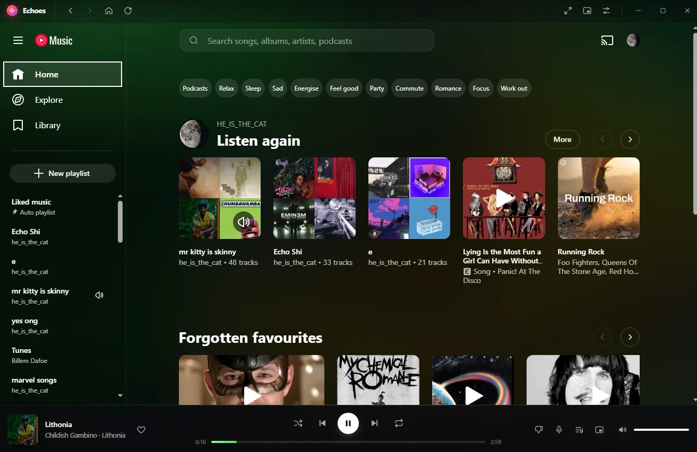
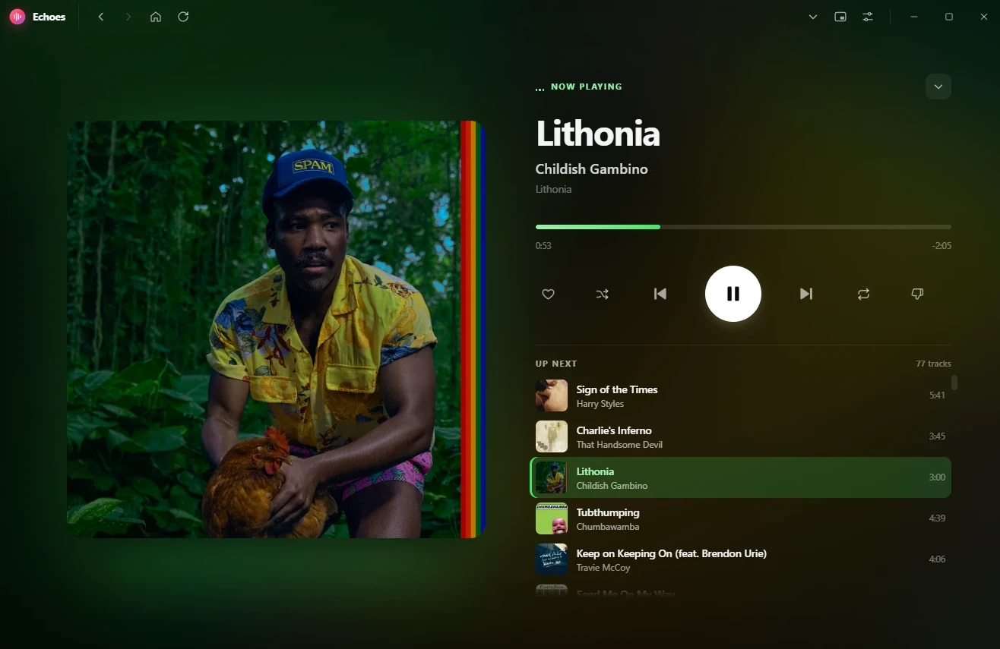
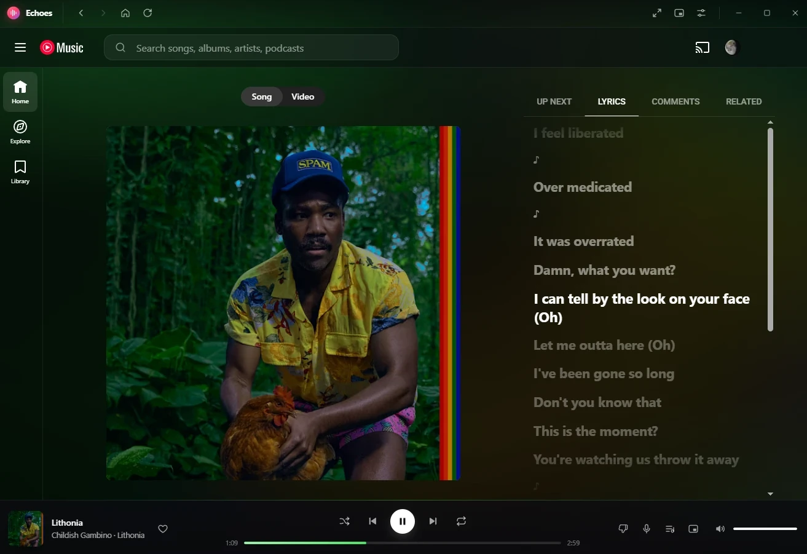
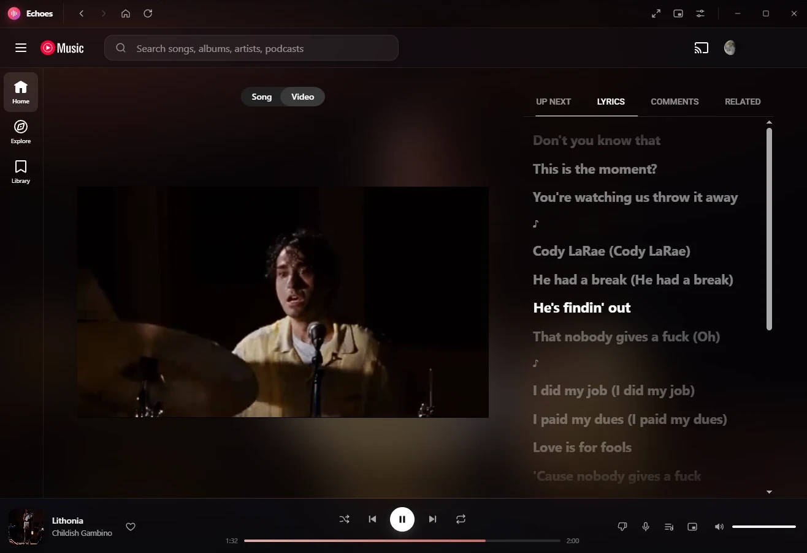
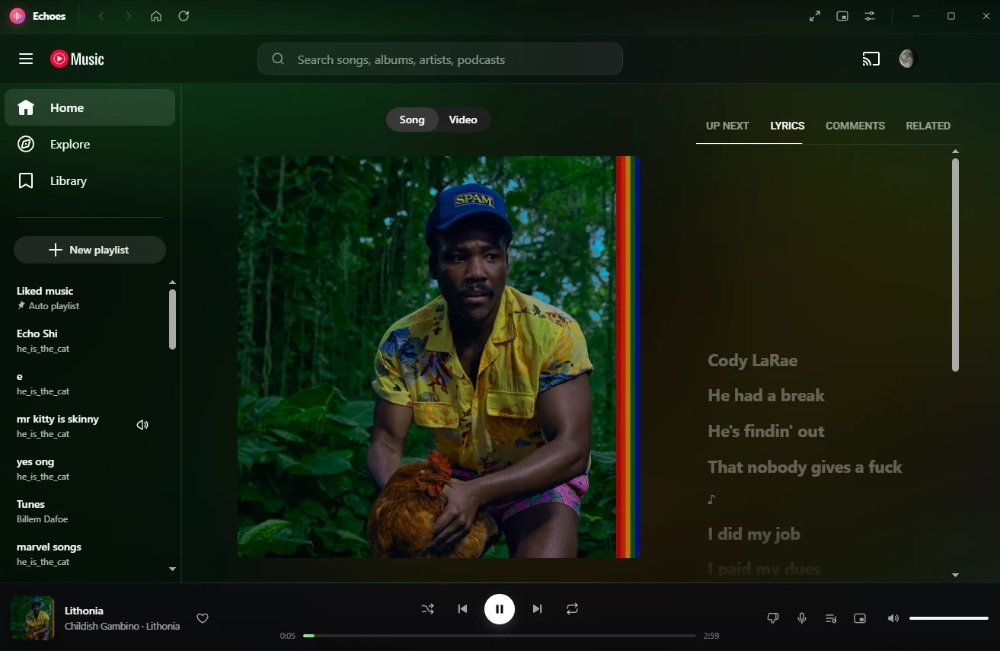
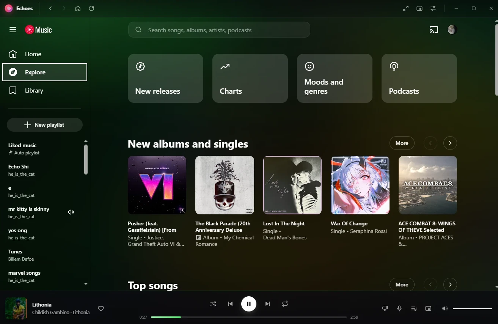
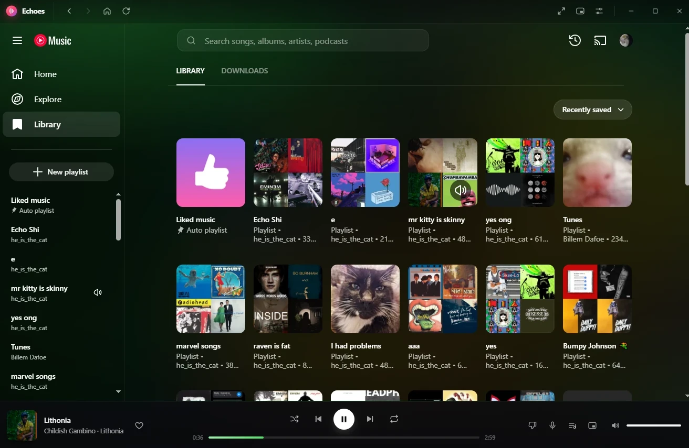

<p align="center">
  
</p>

<h1 align="center">Echoes</h1>

<p align="center">
  <b>A beautiful desktop app for YouTube Music.</b><br/>
  Native window, a redesigned player, and colors that follow the music.
</p>

<p align="center">
  
  
  
</p>

<p align="center">
  
</p>

---

YouTube Music has no official desktop app. Echoes is one. It runs the real YouTube Music
web player, so you **sign in with your own Google account** and keep your library, likes,
playlists, and Premium. Around the player it draws its own interface.

## Features

- **🎬 Music video background.** When a track has a music video, it plays softly behind the
  whole app. Tracks without one get an ambient glow from the album art. On by default; you
  can turn it off in Settings.
- **🎨 Colors from the artwork.** The accent color is taken from each song's album art, and
  the progress bar, buttons, and glow all fade to the new color when the track changes.
- **Redesigned player bar.** A glass bar with smooth seeking, a hover time preview, an
  animated like button, and repeat/shuffle indicators.
- **Now Playing view.** A full-window scene with large artwork, display type, big
  controls, and a clickable **Up Next** queue with cover art for every track.
- **🎤 Synced lyrics.** The microphone button opens the player on the Lyrics tab. Lyrics
  scroll in time with the song, the current line is highlighted, and you can click any
  line to jump there. Timed lyrics come from [LRCLIB](https://lrclib.net); songs it
  doesn't have fall back to YouTube Music's own lyrics. The timings match the album
  version, so in **Video** mode (where the music video's length differs) you get YouTube
  Music's regular lyrics instead.
- **Dark everywhere.** The app is always dark, and Google's sign-in and consent pages use
  their own dark themes too.
- **🛡️ Built-in ad blocker.** Blocks ads and trackers with uBlock Origin's filter lists
  (through [Ghostery's adblocker engine](https://github.com/ghostery/adblocker), since the
  uBlock Origin extension itself can't run in Electron). On by default; turn it off in
  Settings. If an ad does get through, the player bar labels it instead of showing the
  ad's length as the song's.
- **Mini player.** A 340 × 340 always-on-top window of the artwork (or video), with
  controls that appear on hover.
- **Native desktop features:**
  - Frameless window with custom controls
  - Taskbar thumbnail buttons on Windows
  - System tray menu
  - OS media keys and the media overlay
  - Remembers window position and size
  - Single-instance lock
- **Restyled YouTube Music.** Transparent backgrounds that take on the song's colors,
  glass menus, softer cards, chip rows that always fit on one line, and slim scrollbars.
- **🎮 Discord status.** Turn on **Show on Discord** in Settings to show "Listening to
  YouTube Music" on your profile with the song, artist, cover art, a live progress bar, and
  buttons to play the song or get Echoes. Discord only shows it when **Share your detected
  activities with others** is on (Discord → User Settings → Activity Privacy).
- **🔋 Power saving mode.** Turns off the video background, animations and film grain,
  drops music videos to their lowest quality (audio is unaffected), redraws the player
  once a second, and slows background checks.
- **Settings.** Video background, soft focus (blur), album-art colors, close to tray, ad
  blocking, Discord status, power saving.

## Screenshots

| | |
|---|---|
|  |  |
| **Now Playing** with the Up Next queue | **Synced lyrics** that follow the song |
|  |  |
| **Music video** with lyrics alongside | **Player page** in the song's colors |
|  |  |
| **Explore** | **Library** |

## Install

### From source

You need [Node.js](https://nodejs.org) 20 or newer.

```bash
git clone https://github.com/heisthecat31/Echoes.git
cd Echoes
npm install
npm start
```

### Build an installer

```bash
npm run dist        # current platform
npm run dist:win    # Windows NSIS installer + portable .exe
npm run dist:mac    # macOS .dmg
npm run dist:linux  # AppImage + .deb
```

The output goes to `dist/`. The installed or portable app runs as **Echoes.exe**, so it
shows up as "Echoes" in Task Manager. (`npm start` runs through the generic Electron
binary, which Windows lists as "Electron". To run the real app without installing it,
use `npm run app`.)

## Keyboard shortcuts

| Action | Shortcut |
|---|---|
| Play / pause | `Space` |
| Next / previous track | `Ctrl` + `→` / `Ctrl` + `←` |
| Now Playing | `Ctrl` + `Shift` + `F` |
| Mini player | `Ctrl` + `Shift` + `M` |
| Settings | `Ctrl` + `,` |
| Back / forward | `Alt` + `←` / `Alt` + `→` |
| Reload | `Ctrl` + `R` |
| Close Now Playing / Settings | `Esc` |

On macOS, use `Cmd` instead of `Ctrl`.

## How it works

```
┌──────────────── Echoes window ────────────────┐
│ Title bar            (Echoes UI)               │
├────────────────────────────────────────────────┤
│                                                │
│  music.youtube.com   (WebContentsView,         │
│                       transparent, restyled)   │
│                                                │
├────────────────────────────────────────────────┤
│ Player bar           (Echoes UI)               │
└────────────────────────────────────────────────┘
   behind it all: music video / album-art ambient layer
```

- `src/main/` holds the Electron main process. It manages the window and views, the tray
  and taskbar buttons, settings, and album-art color extraction.
- `src/inject/bridge.js` runs inside YouTube Music. It reads the player state and the
  Media Session, carries out commands (play, seek, like…), and streams small video frames
  for the background.
- `src/inject/theme.css` restyles YouTube Music and hides its own player bar.
- Synced lyrics are looked up from LRCLIB by the main process and drawn by `bridge.js` as
  a panel over YouTube Music's Lyrics tab.
- `src/renderer/` is the Echoes interface: title bar, player bar, Now Playing, mini
  player, and Settings.
- `DESIGN.md` is the design spec: tokens, components, and motion.

**Privacy:** Echoes doesn't collect anything and has no server. Your Google session is
stored locally in Electron's profile folder, the same way a browser stores it. To find
synced lyrics, Echoes sends the current song's title, artist, album and length to
[LRCLIB](https://lrclib.net), a free, open lyrics database. The ad blocker downloads
uBlock Origin's filter lists from Ghostery's GitHub repository every few days. Nothing
else is sent.

### Designing the UI without Electron

`src/renderer/index.html` runs on its own in any browser with a built-in demo player. That
includes fake tracks, a queue, and a fake video feed. Serve the folder with any static
server and open:

- `/` for the main window
- `/?mode=nowplaying` for Now Playing
- `/?mode=mini` for the mini player
- `/?mode=settings` for Settings

## Troubleshooting

**"This browser or app may not be secure" when signing in.** Echoes sends a standard
browser user agent to Google's sign-in pages to avoid this. If Google still blocks it, try
again after a few minutes, or turn on 2-step verification and sign in with your phone.

**The video background isn't showing.** Not every track has a music video. Songs that are
audio-only (with a static cover) use the album-art glow instead. Check that **Settings →
Music video background** is on.

**YouTube changed something and a button stopped working.** YouTube Music's page structure
changes from time to time. The selectors are all in `src/inject/bridge.js`. Pull requests
are welcome.

## Contributing

Issues and PRs are welcome. Keep the look in line with `DESIGN.md`. Run `npm run dev` to
start with DevTools shortcuts: `Ctrl+Shift+I` opens DevTools for the Echoes UI, and
`Ctrl+Shift+J` opens it for the YouTube Music page.

Icons are generated from SVG with `npm run icons`.

## Disclaimer

Echoes is an unofficial, community project. It is not affiliated with, endorsed by, or
sponsored by YouTube or Google. "YouTube" and "YouTube Music" are trademarks of Google
LLC. Echoes doesn't download, rip, or redistribute content. It shows the official web
player.

## License

[MIT](LICENSE)
